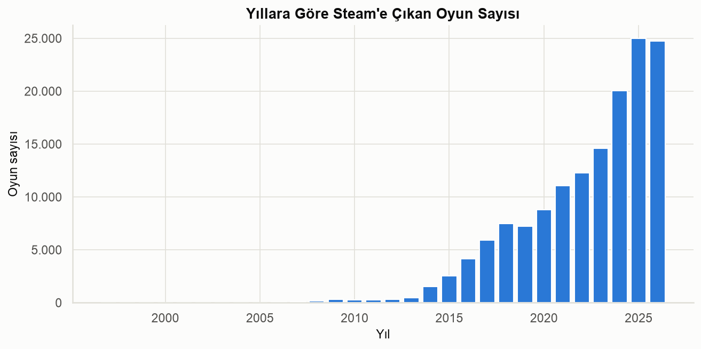
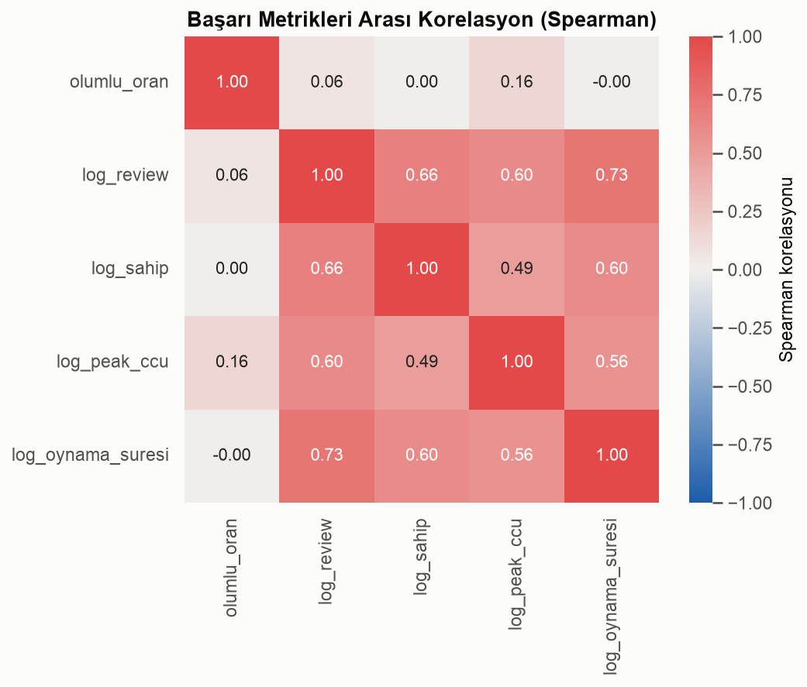
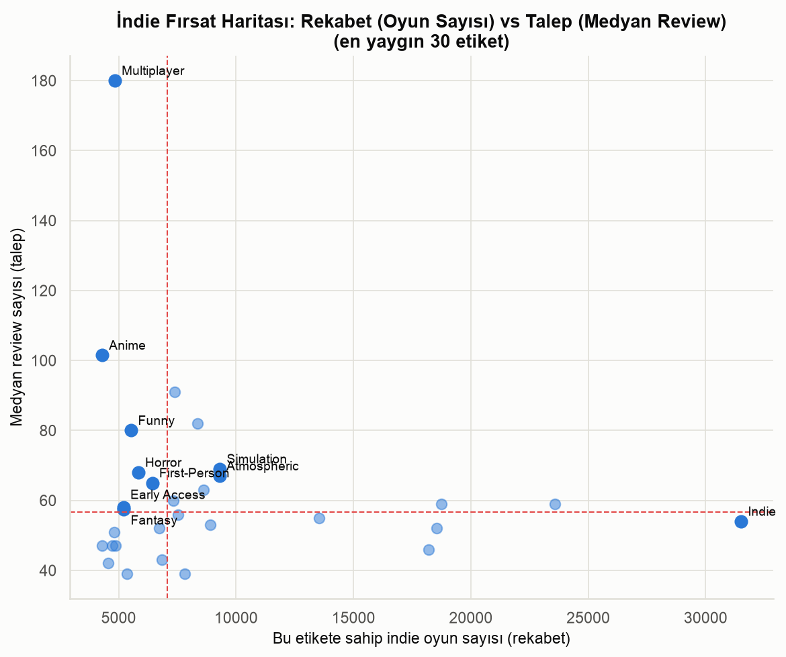
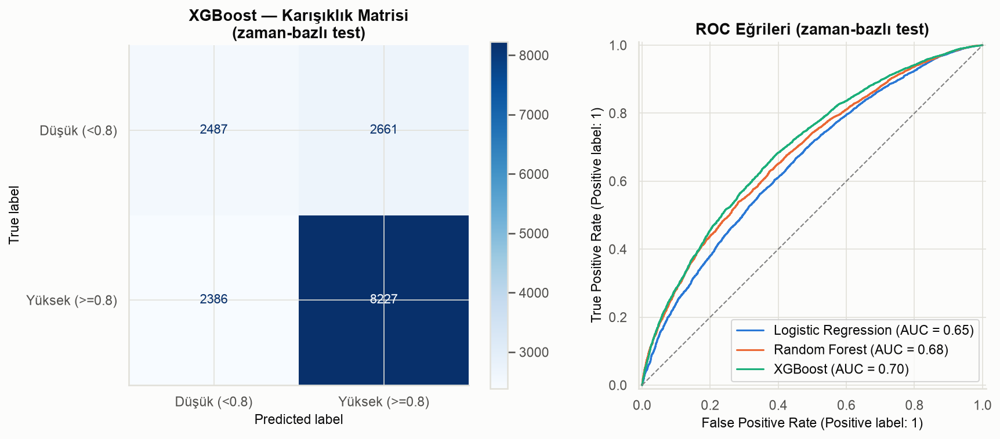

# steam-indie-insights

Steam'de yayınlanmış **147.352 oyunun** verisini kullanarak oyun pazarını uçtan uca analiz eden bir veri bilimi projesi. Ana soru:

> **"Steam'de bir oyunun (özellikle bir indie oyunun) başarılı olmasını hangi faktörler belirliyor?"**

Veri seti: [Steam Games Dataset — FronkonGames (Kaggle)](https://www.kaggle.com/datasets/fronkongames/steam-games-dataset)

## Öne Çıkan Bulgular

- **Popüler olmak ≠ kaliteli olmak.** Review/sahip sayısı/Peak CCU birbirleriyle çok yüksek korelasyonlu, ama olumlu oranla (kalite) korelasyonları zayıf.
- **"Shovelware" net şekilde tespit edilebiliyor:** bazı geliştiriciler oyunlarının %100'ünde hiç review almamış; buna karşın benzer hacimde kaliteli üretim yapan stüdyolar da var.
- **İndie fırsat haritası:** "Multiplayer" ve "Anime" etiketleri görece az rekabetle yüksek talep gösteriyor.
- **Çıkış-öncesi özellikler başarıyı sınırlı ölçüde açıklıyor** (en iyi model, XGBoost, zaman-bazlı testte ROC-AUC≈0.70) — dil desteği, başarım sayısı ve tür odağı en güçlü sinyaller arasında.

Tüm bulgular ve yorumlar için bkz. **[reports/RAPOR.md](reports/RAPOR.md)**.

| | |
|---|---|
|  |  |
|  |  |

## Kurulum ve Çalıştırma

```bash
python3 -m venv .venv
source .venv/bin/activate
pip install -r requirements.txt
```

Kaggle API anahtarınızı (`~/.kaggle/kaggle.json` veya `~/.kaggle/access_token`) ayarladıktan sonra veriyi indirin:

```bash
kaggle datasets download -d fronkongames/steam-games-dataset -p data/raw --unzip
```

Notebook'ları sırayla çalıştırın (her biri bir önceki fazın çıktısına bağlıdır):

```bash
jupyter nbconvert --to notebook --execute --inplace notebooks/01_veri_inceleme.ipynb
jupyter nbconvert --to notebook --execute --inplace notebooks/02_veri_temizleme.ipynb
jupyter nbconvert --to notebook --execute --inplace notebooks/03_kesifsel_analiz.ipynb
jupyter nbconvert --to notebook --execute --inplace notebooks/04_derin_analizler.ipynb
jupyter nbconvert --to notebook --execute --inplace notebooks/05_modelleme.ipynb
```

veya Jupyter Lab/Notebook ile açıp "Restart & Run All" yapabilirsiniz.

> **Not:** `data/raw/` ve `data/processed/` git'e eklenmez (`.gitignore`) — `data/processed/games_clean.parquet` **132 MB**, GitHub'ın normal push için koyduğu 100 MB'lık sert sınırı aşıyor. Bu dosya `02_veri_temizleme.ipynb` çalıştırıldığında yeniden üretilir.

> **macOS notu:** `xgboost`/`lightgbm`, Homebrew yoksa eksik olabilen bir `libomp` çalışma zamanı kütüphanesi gerektirir. Homebrew varsa `brew install libomp` yeterli. Yoksa ve sistemde Anaconda/Miniconda kuruluysa, aşağıdaki gibi venv içindeki kütüphaneye conda'nın `libomp`'unu rpath olarak ekleyebilirsiniz (tek seferlik, sadece bu venv için):
> ```bash
> install_name_tool -add_rpath /opt/anaconda3/lib .venv/lib/python3.*/site-packages/xgboost/lib/libxgboost.dylib
> install_name_tool -add_rpath /opt/anaconda3/lib .venv/lib/python3.*/site-packages/lightgbm/lib/lib_lightgbm.dylib
> ```

## Klasör Yapısı

```
steam-indie-insights/
├── data/
│   ├── raw/            # Kaggle'dan inen orijinal dosyalar (git'e eklenmez)
│   └── processed/      # Temizlenmiş veri (games_clean.parquet)
├── notebooks/
│   ├── 01_veri_inceleme.ipynb      # Faz 1 — CSV/JSON karşılaştırması, veri sözlüğü
│   ├── 02_veri_temizleme.ipynb     # Faz 2 — temizleme, özellik türetme
│   ├── 03_kesifsel_analiz.ipynb    # Faz 3 — zaman/fiyat/tür/başarı/platform/geliştirici (21 grafik)
│   ├── 04_derin_analizler.ipynb    # Faz 4 — başarı tanımı, indie fırsat haritası, istatistik, metin analizi
│   └── 05_modelleme.ipynb          # Faz 5 — baseline → Logistic Regression → Random Forest → XGBoost, SHAP
├── src/
│   ├── load.py          # Ham veri yükleme
│   ├── clean.py         # Temizleme ve özellik türetme fonksiyonları
│   ├── features.py      # Multi-hot encoding yardımcıları
│   └── plots.py         # Ortak grafik stili ve renk paleti
├── reports/
│   ├── figures/         # Tüm grafikler (PNG, numaralı)
│   └── RAPOR.md         # Tam analiz raporu ve öneriler
├── requirements.txt
└── .gitignore
```
