# Steam Oyunları — Kapsamlı Veri Analizi Raporu

**Veri seti:** [Steam Games Dataset — FronkonGames (Kaggle)](https://www.kaggle.com/datasets/fronkongames/steam-games-dataset), 147.352 oyun.
**Ana soru:** Steam'de bir oyunun (özellikle bir indie oyunun) başarılı olmasını hangi faktörler belirliyor?

---

## Özet — En Önemli 7 Bulgu

1. **Popüler olmak ≠ kaliteli olmak.** Review sayısı, tahmini sahip sayısı ve Peak CCU birbirleriyle çok yüksek korelasyonlu, ama hepsinin olumlu oranla (kalite) korelasyonu zayıf. Oyunların sadece **%8,7'si** hem yüksek kaliteli hem yüksek popüler; %9,3'ü kaliteli ama dar kitleli bir "gizli cevher".
2. **Steam, giderek daha indie-yoğun ve daha rekabetçi bir pazar.** İndie oyunlar veri setinin %67'sini oluşturuyor; yıllık çıkış sayısı 2014'ten beri katlanarak büyüdü.
3. **Dil ve başarım desteği, görece ucuz ama etkili yatırımlar.** Başarılı (üst %10) indie oyunlar medyanda 5 dil desteklerken diğerleri 2 dilde kalıyor (22 vs 11 başarım).
4. **"Shovelware" net şekilde tespit edilebiliyor.** Bazı geliştiriciler (ör. "EroticGamesClub", "Bully Revenge Studios") çıkardıkları oyunların %100'ünde hiç review almamış; buna karşın çok-üretken ama kaliteli stüdyolar (ör. "Choice of Games") da var — miktar tek başına kalitesizlik göstergesi değil.
5. **İstatistiksel olarak anlamlı ama pratikte küçük etkiler.** Ücretsiz/ücretli, indie/indie-olmayan, kendi-yayıncısı/yayıncılı karşılaştırmalarının hepsi anlamlı (p≪0.001) ama etki büyüklüğü küçük (|r|≤0.12) — tek bir faktör başarıyı belirlemiyor.
6. **Çıkış-öncesi özellikler başarıyı sınırlı ölçüde açıklıyor.** En iyi model (XGBoost) zaman-bazlı testte ROC-AUC≈0.70'e ulaşıyor — rastgele tahminden belirgin iyi ama mükemmelden çok uzak.
7. **Metin analizi bir "tema" sinyali ortaya koyuyor.** Başarılı indie açıklamalarında özgünlük/sanat/hikâye vurgusu (puzzle, unique, story, art) öne çıkarken, başarısızlarda doymuş "survival/zombie/weapons" teması baskın.

---

## Veri ve Yöntem

- **Kaynak:** Kaggle'daki veri setinin hem CSV hem JSON versiyonu incelendi. CSV'de bir header/veri kayması (bir "Discount"+"DLC count" birleşmiş başlık yüzünden tüm kolonlar 1 kayıyor) tespit edildiği için **JSON versiyonu** esas alındı (ayrıntı: `notebooks/01_veri_inceleme.ipynb`).
- **Temizleme:** Tarih/sahiplik aralığı sayısallaştırıldı, liste/sözlük alanlarından (`genres`, `categories`, `tags`) sayısal özellikler türetildi, 14 gereksiz kolon atıldı, aykırı değerler silinmedi (log1p dönüşümü eklendi). Temiz veri `data/processed/games_clean.parquet`.
- **İki seviyeli analiz:** Review'a dayalı metrikler (`positive_ratio` gibi) için analizler hem tüm veri hem de **en az 10 review'u olan oyunlar** (`has_enough_reviews`) üzerinde ayrı ayrı yapıldı — bu eşiğin altında oran tek bir review ile %0-%100 arası sıçrayabiliyor.
- **`is_indie` tanımı:** `genres` alanı kullanıldı (`tags` değil) — `tags` topluluk oyuna dayalı ve düşük-review'lu oyunların %43'ünde tamamen boş; `genres` ise listeleme anında atanıyor ve her oyunda mevcut.

---

## Zaman, Fiyat, Tür/Etiket Analizi (Faz 3)

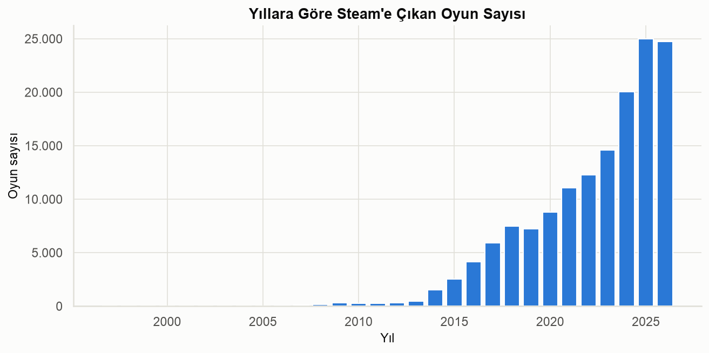

Steam'e çıkan oyun sayısı 2014'ten itibaren katlanarak büyüdü; 2024-2025 en yoğun yıllar. Fiyatlar yıllar içinde kademeli olarak düştü, ücretsiz oyun oranı arttı (`03_03`). Oyunlar neredeyse tamamen hafta içi, özellikle Cuma günleri çıkıyor (`03_02`).

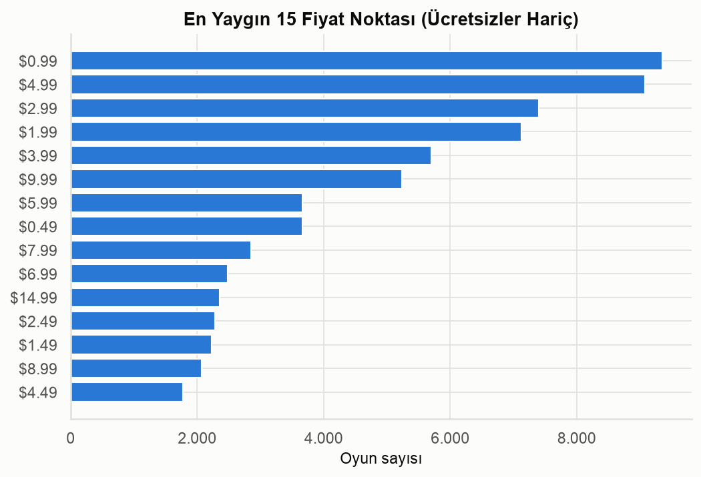

Fiyatlandırma klasik psikolojik basamaklarda ($0.99, $4.99, $9.99, $19.99) yoğunlaşıyor — indie geliştiricilerin büyük kısmı yerleşik fiyat noktalarını takip ediyor.

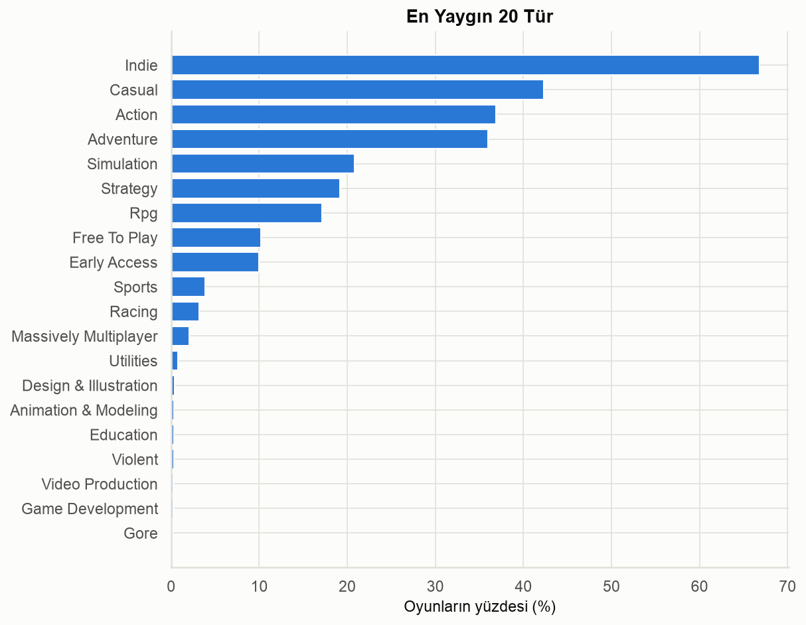

Indie, veri setindeki en yaygın tür etiketi (%67) — bu, Steam'in artık ağırlıklı olarak indie-yoğun bir ekosistem olduğunu gösteriyor.

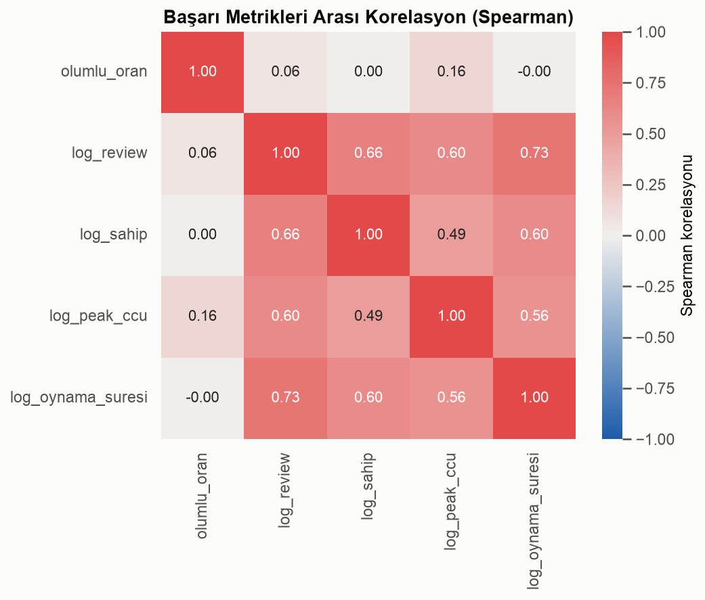

Review sayısı, sahip sayısı ve Peak CCU birbirleriyle çok yüksek korelasyonlu (hepsi "popülerlik"); olumlu oranla korelasyonları ise zayıf — **popüler olmak kaliteli olmakla aynı şey değil.**

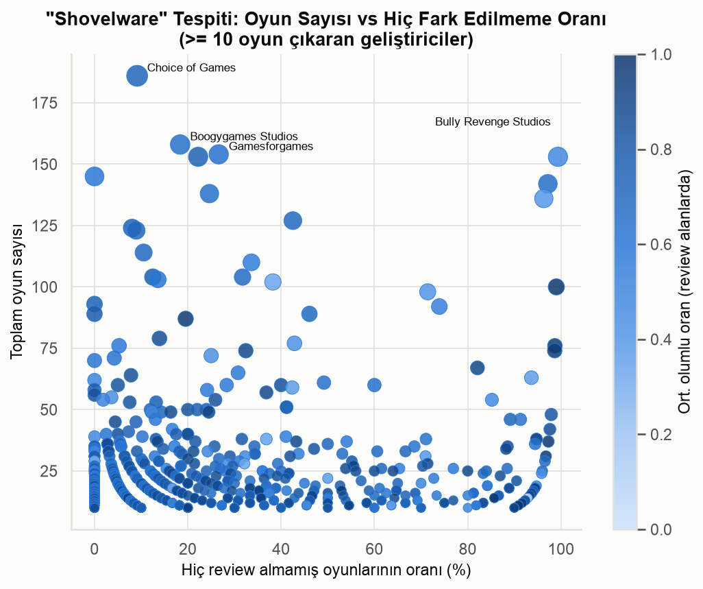

Çok sayıda oyun çıkaran bazı geliştiriciler oyunlarının tamamına yakınında hiç review almıyor (klasik "shovelware"); buna karşın benzer hacimde ama kaliteli üretim yapan stüdyolar da var.

*(Diğer tüm grafikler: `reports/figures/03_*.png` — platform/dil desteği, geliştirici/yayıncı karşılaştırmaları, etiket co-occurrence ısı haritası dahil.)*

---

## Derin Analizler (Faz 4)

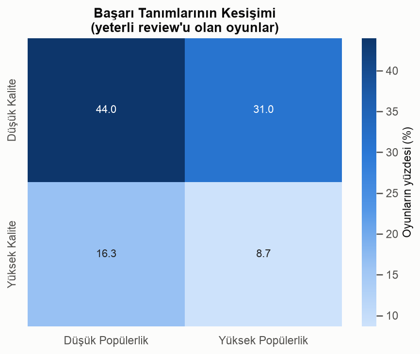

Kalite (üst çeyrek `positive_ratio`) ve popülerlik (üst çeyrek `owners_mid`) kesişimi küçük: oyunların sadece %8,7'si her ikisinde de yüksek.

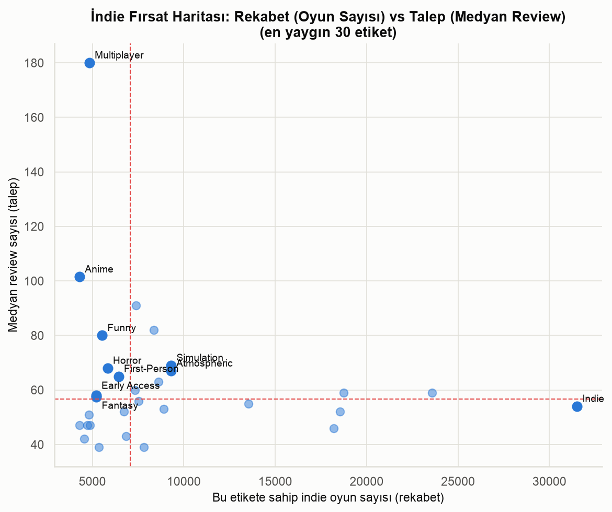

En yaygın 30 etiket için rekabet (oyun sayısı) vs talep (medyan review) haritası: **"Multiplayer"** ve **"Anime"** görece az rekabetle yüksek talep gösteriyor; "Simulation"/"Atmospheric" ise doymuş durumda.

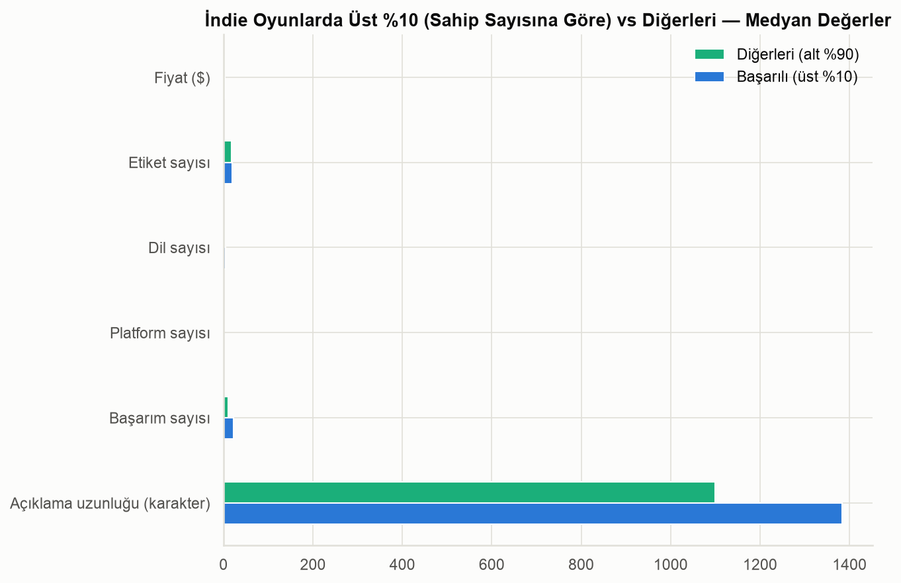

Başarılı (üst %10) indie oyunlar belirgin şekilde daha fazla dil ve başarım içeriyor — düşük maliyetli, potansiyel etkisi yüksek yatırımlar.

İstatistiksel testler (Mann-Whitney U): ücretsiz/ücretli, indie/indie-olmayan ve kendi-yayıncısı/yayıncılı karşılaştırmalarının hepsi istatistiksel olarak anlamlı (p≪0.001) ama etki büyüklüğü (rank-biserial |r|) hepsinde küçük (0,01-0,12) — büyük örneklem, küçük gerçek farkları bile anlamlı gösteriyor.

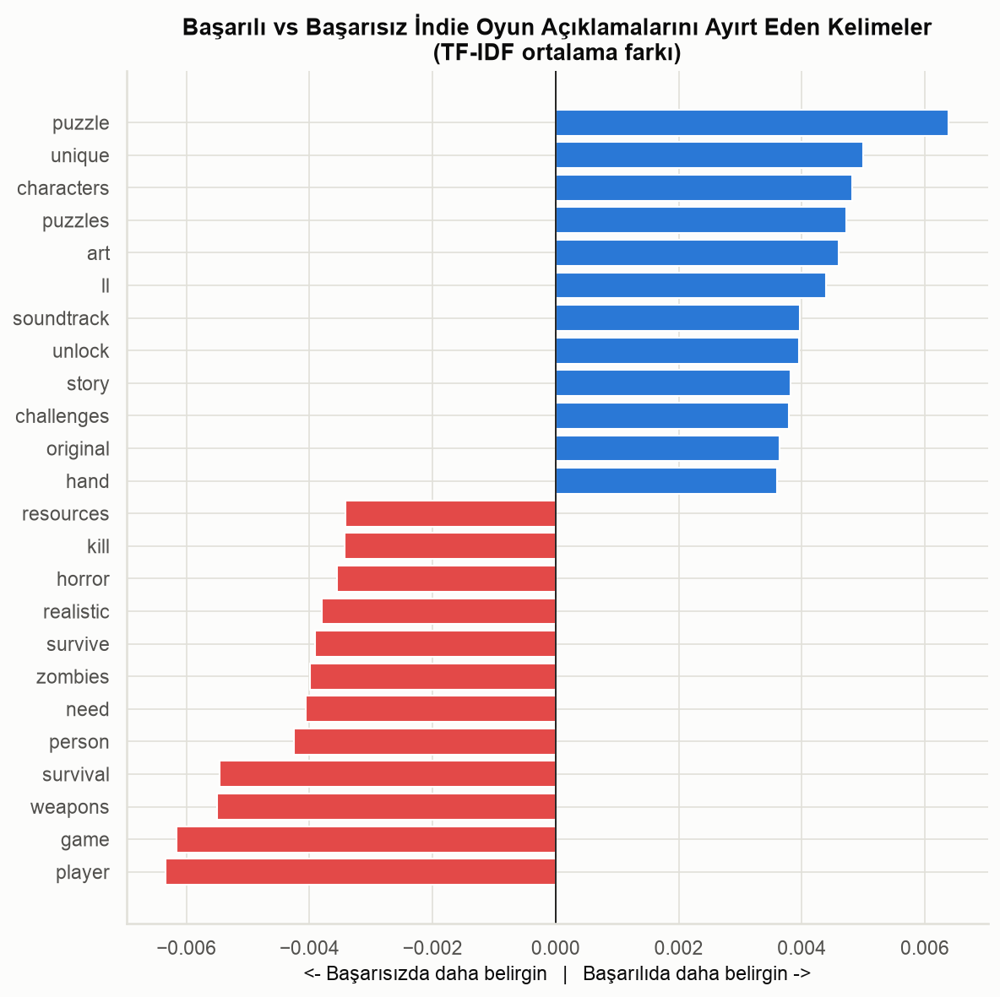

TF-IDF ile başarılı indie oyun açıklamalarında özgünlük/sanat vurgusu (*puzzle, unique, story, art, soundtrack, cute*) öne çıkarken, başarısızlarda doymuş "survival/zombie" teması (*survival, zombies, weapons, realistic*) baskın — korelasyonel bir gözlem, nedensellik iddiası değil.

*(Diğer grafikler: fiyat-kalite ilişkisi, türlere göre oynama süresi — `reports/figures/04_*.png`.)*

---

## Model Sonuçları (Faz 5)

**Görev:** Çıkış-öncesi bilinebilen özelliklerden `positive_ratio >= 0.8` ("Very Positive ve üzeri") tahmini. Veri sızıntısından kaçınmak için review/sahip sayısı/oynama süresi/Metacritic gibi çıkış-sonrası metrikler **kullanılmadı**; ayrıca topluluk kaynaklı `tags` da sızıntı riski nedeniyle bilinçli olarak dışlandı (ayrıntı: `notebooks/05_modelleme.ipynb`).

| Model | Accuracy | Precision | Recall | F1 | ROC-AUC |
|---|---|---|---|---|---|
| Baseline (çoğunluk sınıfı) | 0.327 | 0.000 | 0.000 | 0.000 | 0.500 |
| Logistic Regression | 0.676 | 0.726 | 0.834 | 0.776 | 0.654 |
| Random Forest | 0.667 | 0.748 | 0.762 | 0.755 | 0.680 |
| **XGBoost** | **0.680** | **0.756** | **0.775** | **0.765** | **0.695** |

*(Zaman-bazlı ayrım: 2022 ve öncesiyle eğitim, 2023+ ile test. Baseline'ın düşük accuracy'si bir model hatası değil — train/test arasında hedef oranı %48→%67 kaydığı için kaynaklanıyor.)*

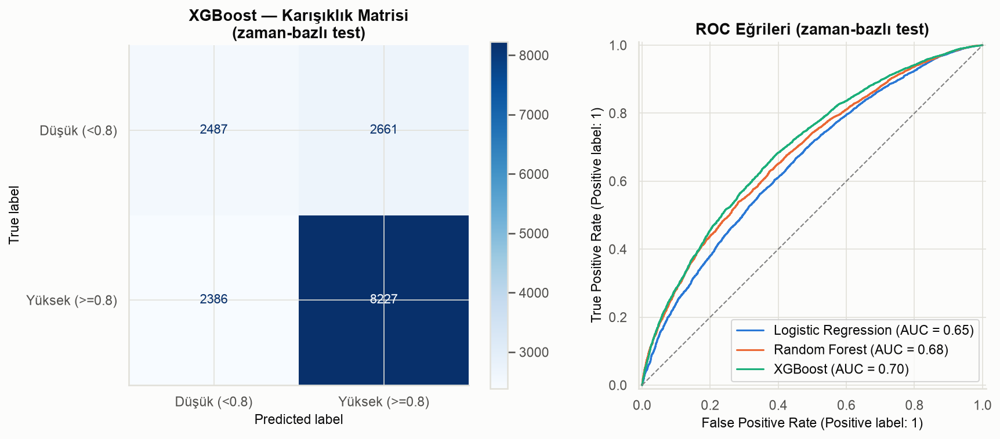

Rastgele ayrımda XGBoost ROC-AUC'u ~0.74'e çıkıyor — ama bu iyimser bir üst sınır; zaman-bazlı sonuç (~0.70) gerçek kullanım senaryosunu (henüz çıkmamış bir oyunu tahmin etmek) daha doğru yansıtıyor.

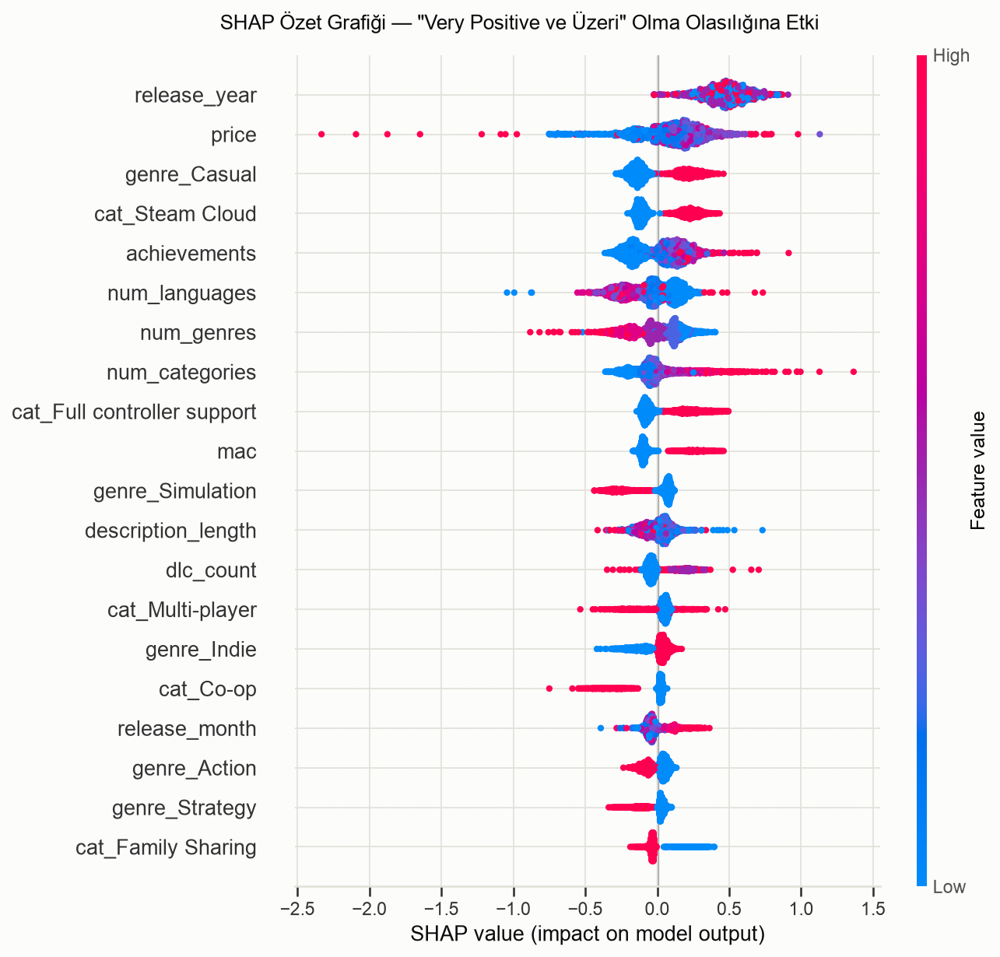

SHAP analizi `genre_Casual`, `cat_Steam Cloud` ve `achievements`'ın pozitif, `num_genres`'in negatif yönde en etkili sinyaller arasında olduğunu gösteriyor (`release_year`'ın en yüksek etkisi muhtemelen zamanla değişen taban oranını yakalıyor, temiz bir tasarım faktörü değil). Hiçbir özellik tek başına baskın değil.

**Gerçekçi yorum:** ROC-AUC ~0.70 düşük-orta bir performans; bu da önemli bir bulgu: oyun kalitesi/karşılanma biçimi, mağaza sayfasındaki özelliklerden çok daha fazlasına (oynanış kalitesi, pazarlama zamanlaması, şans, topluluk dinamikleri) bağlı görünüyor.

---

## Bir İndie Geliştiriciye Öneriler

Bu bulgular **korelasyoneldir**, nedensellik kanıtlamaz — ama veriye dayalı, uygulanabilir ipuçları sunuyor:

1. **Dil desteğine yatırım yapın.** Başarılı indie oyunlar medyanda 5 dil desteklerken diğerleri 2'de kalıyor; çok-dilli lokalizasyon görece ucuz, etkisi büyük bir yatırım.
2. **Başarım sistemi ekleyin.** Başarılı indie oyunlarda medyan başarım sayısı 22, diğerlerinde 11 — oyuncu bağlılığını artıran, düşük maliyetli bir özellik.
3. **Doymuş "survival/zombie/crafting" temalarından kaçının**, özgünlük ve sanat yönünü (hikâye, müzik, görsel kimlik) öne çıkarın — metin analizi bunun başarıyla ilişkili olduğunu gösteriyor.
4. **"Multiplayer" ve "Anime" nişlerini değerlendirin** — fırsat haritasında görece az rekabetle yüksek talep gösteriyorlar; ama "Simulation"/"Atmospheric" gibi doymuş alanlarda fark edilmek daha zor.
5. **$5-10 fiyat aralığını göz önünde bulundurun** — bu aralık en yüksek medyan kaliteyle ilişkili; çok düşük veya çok yüksek fiyatlar daha değişken sonuçlar veriyor.
6. **Tek bir faktöre güvenmeyin.** İstatistiksel testler gösteriyor ki ücretsiz olmak, indie olmak veya kendi yayıncınız olmak tek başına büyük bir fark yaratmıyor; başarı birçok küçük kararın toplamı.
7. **Mac/Linux desteğini bir "özen sinyali" olarak düşünün** — platformun kendisinden çok, bunu sağlayacak kaynak/özenin işareti olabilir.

---

## Sınırlılıklar

- **`estimated_owners` tahmini bir aralık** (ör. "20000-50000"), Valve tarafından yayınlanan kesin bir sayı değil; bu analizde aralığın orta noktası (`owners_mid`) kullanıldı.
- **Review'u olmayan oyunlar** (%43,7) `positive_ratio` hesaplamalarının dışında tutuldu; bu oyunların "neden" fark edilmediği (kalite mi, pazarlama mı, zamanlama mı) bu veriyle ayırt edilemiyor.
- **Korelasyon ≠ nedensellik.** Faz 4 ve Faz 5'teki tüm ilişkiler gözlemseldir; örneğin çok-dil desteğinin başarıyı "sağladığı" değil, büyük/iyi kaynaklı projelerin hem çok dil desteklediği hem başarılı olduğu da mümkündür.
- **Veri belirli bir tarihte alınmış bir anlık görüntü**; JSON ve CSV versiyonları arasındaki satır sayısı farkı (147.352 vs 125.855) iki dosyanın tam olarak aynı anda üretilmediğini gösteriyor.
- **`review_label` sınıflandırması** Steam'in gerçek (halka açık olmayan) algoritmasının basitleştirilmiş bir yaklaşımıdır, resmi eşiklerle birebir örtüşmeyebilir.
- **Model performansı mütevazı** (ROC-AUC ~0.70); bu modelin gerçek dünyada bağımsız bir "başarı tahmincisi" olarak kullanılması önerilmez, sadece hangi faktörlerin kısmi sinyal taşıdığını göstermek amaçlıdır.
